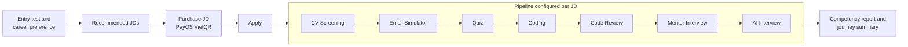
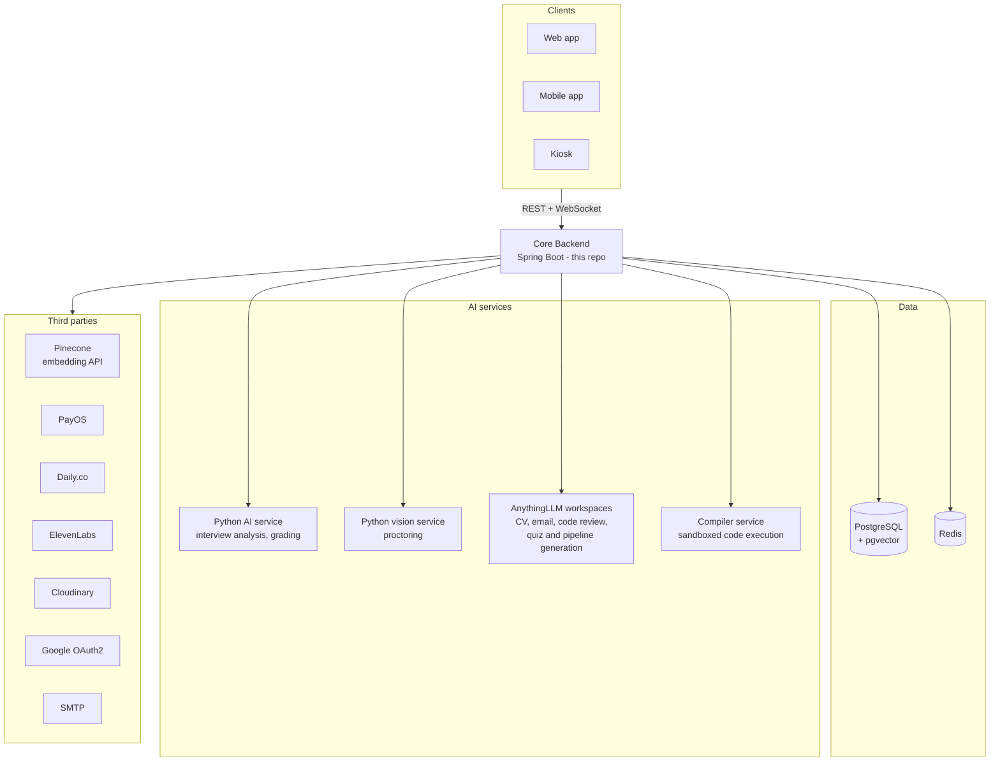
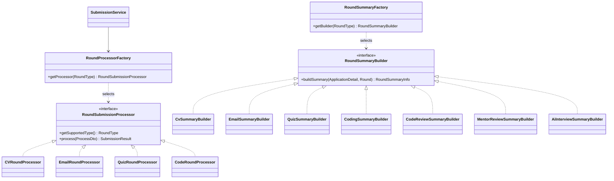
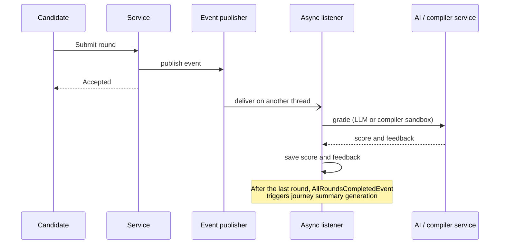
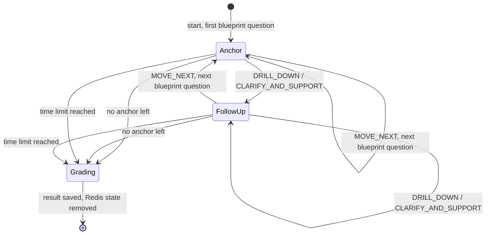

<div align="center">
  <h1>Inblue — AI-Powered Recruitment Process Simulation</h1>
  <p>Core backend of a platform that lets Software Engineering students practise a full, realistic hiring pipeline, ending in a virtual AI interview room.</p>
  <p>
    
    
    
    
    
    
    
  </p>
</div>

## Overview

Inblue simulates the recruitment process of a real company. A candidate takes an entry test, gets job descriptions (JDs) recommended for their level, applies to one, and then goes through that JD's pipeline of up to seven round types. At the end they receive a competency report and a summary of the whole journey.

This repository is the **core backend**. It owns all business logic and the REST/WebSocket API used by the web app, the mobile app and the physical kiosk. AI work (CV parsing, question generation, grading) is delegated to separate services; this backend orchestrates them and keeps the state.

FPT University capstone project — group GSU26SE27, project code SU26SE018.

## Roles

| Role | What they do |
| --- | --- |
| Candidate | Takes the entry test, applies to JDs, completes rounds, views reports, uses the community and chat |
| Mentor | Runs 1-on-1 video interviews and submits STAR evaluations |
| Staff | Reviews applications and gives the HR score for each round |
| Admin | Manages users, mentors, companies, JDs, pipelines, question repositories, kiosks and moderation |

## Candidate flow



The order and number of rounds shown are an example; each JD defines its own.

1. **Entry test and career preference.** The result sets the candidate's level and skill profile.
2. **Job recommendation.** JDs are ranked by cosine similarity between the candidate's skill vector and each JD's skill vector, filtered by level.
3. **Purchase and apply.** JD access is paid for with PayOS (VietQR).
4. **Pipeline.** Each JD has its own ordered list of rounds, chosen from:

   | Round type | Description |
   | --- | --- |
   | `CV_SCREENING` | CV upload and ATS match score against the JD |
   | `EMAIL_SIMULATOR` | Professional email task, graded by AI |
   | `QUIZ` | Multiple-choice technical test |
   | `CODING` | Algorithm problems, judged automatically by a sandbox compiler service |
   | `CODE_REVIEW` | Find the issues in a given piece of code |
   | `MENTROR_REVIEW` | 1-on-1 video interview with a mentor over Daily.co, STAR evaluation |
   | `AI_INTERVIEW` | Voice/text interview with an AI interviewer, on the web or at a kiosk |

5. **Report.** A six-axis competency chart based on SWECOM, plus a journey summary.

## Key features

### AI interview
- **Blueprint.** When a session is created, the AI builds an interview script from the candidate's profile and the JD: phases, each with ordered anchor questions.
- **Java-controlled state machine.** The backend walks the blueprint. After each answer the AI only returns one decision: `DRILL_DOWN` (ask a follow-up), `CLARIFY_AND_SUPPORT`, `MOVE_NEXT` or `FINISH`.
- **Resumable sessions.** Session state is saved to Redis after every answer (2-hour TTL), so a candidate can reload and continue.
- **Grading.** Each anchor question is graded together with its follow-ups as one group. The round score is the average of the groups; Staff then add an HR score.
- **Voice.** Text-to-speech through ElevenLabs with a fallback provider, speech-to-text over WebSocket, selectable interviewer voices.
- **Proctoring.** Camera snapshots can be sent to a vision service; warnings are stored per question and attached to the result.
- **Kiosk mode.** Candidates book a slot at a physical kiosk and check in with a 6-digit PIN.

### Pipeline configuration (Admin)
- Build a pipeline by hand, apply a saved template, or generate a draft with AI from the JD.
- Each round carries an evaluation plan: metrics with weight, max score, minimum score and a required flag, plus scoring instructions and a pass rule.
- A Staff reviewer can be assigned per round.

### JD import
- Admin can search TopDev, preview results and import selected JDs.
- On import the company is created if missing, skill tags are extracted by AI (falling back to the source's own tags) and a skill embedding is generated. Imported JDs start as `DRAFT`.

### Other modules
- Mentor booking, schedule confirmation, mentor suggestion by JD skills, two-way reviews.
- Community feed (posts, likes, threaded comments) with moderation.
- Direct messaging and real-time notifications over WebSocket.
- Admin dashboard and question repositories (quiz, coding problems, code review problems).

## Architecture



Notes:
- Pinecone is used only to **generate** embeddings (`llama-text-embed-v2`, 384 dimensions). Vectors are stored and queried in PostgreSQL with pgvector.
- Calls made through AnythingLLM are recorded in `LlmChatLog` with trace ID, prompt, response, token counts and response time.
- Every request carries a `traceId` (Micrometer Tracing) that appears in the JSON logs.

## Design and patterns

### Layered architecture

The code follows the usual Spring layering: `controller` → `service` (interface + `impl`) → `repository`. Entities never leave the service layer directly; requests and responses are DTOs, mapped with MapStruct. The `entrytest` module is packaged by feature and has its own controller, service, repository and model layers.

### Strategy + Factory for rounds

Each round type behaves differently, so round-specific logic sits behind a common interface and is selected by `RoundType` instead of `if/else` chains in the services.



| Concern | Interface (strategy) | Selector (factory) | Implementations |
| --- | --- | --- | --- |
| Handling a submission | `RoundSubmissionProcessor` | `RoundProcessorFactory` | `CVRoundProcessor`, `EmailRoundProcessor`, `QuizRoundProcessor`, `CodeRoundProcessor` |
| Building the round summary for the journey report | `RoundSummaryBuilder` | `RoundSummaryFactory` | One builder for each of the seven round types |

`SubmissionService` resolves the candidate's current round, asks the factory for the matching processor and stores the returned `SubmissionResult`. Code review, mentor interview and AI interview have their own flows (`SubmissionService.evaluateCodeReview`, the mentor module, `InterviewProcessService`) because they are multi-step or real-time rather than a single submission.

Adding a round type means adding a `RoundType` value, a processor and a summary builder, and registering them in the two factories.

### Event-driven, asynchronous work

Slow work is taken off the request thread with Spring application events and `@Async` listeners.

- `SubmissionEventHandle` — grading of CV, email and coding submissions after they are accepted.
- `AllRoundsCompletedEvent` → `JourneySummaryEventListener` — generates the journey summary once the last round is done.
- `EventListenerHandle` — avatar and CV uploads to Cloudinary.
- `LlmChatLogService` — LLM call logs are written asynchronously.



Scheduled jobs in `schedule/` cover work that must not depend on a request, such as fetching and grading emailed submissions, checking payment status, sending meeting reminders, closing expired job descriptions and generating missing summary scripts and audio.

### State machine for the AI interview

`InterviewProcessServiceImpl` drives the interview. The state (current phase, current question, question type, chat history) lives in a Redis document, `InterviewSessionRedis`. Each answer triggers one transition, chosen from the AI's decision: stay on the same anchor with a follow-up, or advance to the next anchor in the blueprint. The LLM never owns the flow.



### Configuration snapshot per round

A round stores its configuration as a JSON document (`Round.RoundConfig`): instructions, time limit, evaluation plan and the content of the round. Quiz questions, coding problems and code review problems are **copied** into the round as snapshots when it is configured, so later edits to the question repository do not change a pipeline that candidates are already taking.

### Gateway to external AI services

All outbound AI calls go through one interface, `ApiClient`: the Python LLM and vision services, AnythingLLM workspaces and the compiler service. It handles serialisation, cleaning of the model's JSON output, mapping to typed responses and call logging, so services never deal with HTTP details.

### Cross-cutting concerns

- **AOP** — `LoggingAspect` wraps controller and service methods and logs their duration and failures.
- **Servlet filters** — `RequestLoggingFilter` logs every request with its trace ID; `JwtAuthenticationFilter` authenticates it.
- **Retry** — Spring Retry (`@Retryable` / `@Recover`) around session creation and other calls to unreliable services.
- **Central error handling** — business errors are raised as `CustomException` with an HTTP status and translated by `GlobalExceptionHandler`.

## Tech stack

| Area | Technology |
| --- | --- |
| Language / framework | Java 21, Spring Boot 4.0 (Web MVC, Data JPA, Validation, AOP, Cache, Actuator) |
| Security | Spring Security, JWT (jjwt), Google OAuth2 client |
| Data | PostgreSQL, Hibernate Vector (pgvector), Redis |
| Integration | OpenFeign, RestTemplate / RestClient, Spring Retry, WebSocket, Spring Mail |
| Tooling | MapStruct, Lombok, springdoc-openapi (Swagger UI), Jsoup, Spotless |
| Delivery | Docker (multi-stage), GitHub Actions, Docker Hub |

## Project structure

```
src/main/java/fpt/org/inblue
├── controller      REST and WebSocket endpoints
├── service         business logic (impl/, submission/, summary/)
├── repository      JPA and Redis repositories, projections
├── model           entities, Redis documents (caching/), DTOs (dto/)
├── entrytest       entry test and career competency module (own layers)
├── security        JWT filter, OAuth2 handler
├── schedule        background jobs
├── Config          Redis, WebSocket, Swagger, PayOS, SWECOM mapping
├── mapper          MapStruct mappers
├── aspect, filter, event, exception, enums, constants, utils, cloudinary
src/main/resources
├── application.properties
├── migration       SQL scripts
└── templates       email templates
docs                FE integration guides, release notes
diagram             PlantUML class, sequence and package diagrams
```

## Getting started

### Prerequisites
- JDK 21
- PostgreSQL with the `vector` extension
- Redis
- The AI services and third-party accounts listed below, for the features that need them

### Configuration

`application.properties` reads everything from environment variables.

| Group | Variables |
| --- | --- |
| Database | `SPRING_DATASOURCE_URL`, `SPRING_DATASOURCE_USERNAME`, `SPRING_DATASOURCE_PASSWORD`, `SPRING_JPA_HIBERNATE_DDL_AUTO`, `SHOW_SQL` |
| Redis | `REDIS_HOST`, `REDIS_PORT`, `REDIS_USERNAME`, `REDIS_PASSWORD` |
| Security | `JWT_SECRET`, `JWT_EXPIRATION_MS`, `GOOGLE_CLIENT_ID`, `GOOGLE_CLIENT_SECRET`, `GOOGLE_REDIRECT_URI`, `GOOGLE_SCOPE` |
| Frontend / docs | `FE_URL`, `APP_OPENAPI_DEV_URL`, `APP_OPENAPI_PROD_URL`, `SWAGGER_USERNAME`, `SWAGGER_PASSWORD` |
| AI services | `PYTHON_LLM_URL`, `PYTHON_VISION_URL`, `ANYTHING_LLM_URL`, `ANYTHING_LLM_API_KEY`, `COMPILER_SERVICE_URL` |
| Embedding | `PINECONE_API_KEY`, optional `PINECONE_EMBEDDING_URL`, `PINECONE_EMBEDDING_MODEL`, `PINECONE_EMBEDDING_DIMENSION` |
| Payment | `PAYOS_CLIENT_ID`, `PAYOS_API_KEY`, `PAYOS_CHECKSUM_KEY`, `PAYOS_RETURN_URL`, `PAYOS_CANCEL_URL` |
| Video call | `DAILY_API_URL`, `DAILY_DOMAIN`, `DAILY_API_KEY`, `DAILY_WEBHOOK_URL`, `MENTOR_CHARGE_AMOUNT` |
| Media | `CLOUDINARY_CLOUD_NAME`, `CLOUDINARY_API_KEY`, `CLOUDINARY_API_SECRET` |
| Mail | `SPRING_MAIL_HOST`, `SPRING_MAIL_PORT`, `SPRING_MAIL_USERNAME`, `SPRING_MAIL_PASSWORD` |

### Database

Enable pgvector in the target database, then apply the scripts in `src/main/resources/migration` as needed:

```sql
CREATE EXTENSION IF NOT EXISTS vector;
```

### Run locally

```bash
./mvnw spring-boot:run
```

The API listens on port 8080. Swagger UI is served by springdoc and is protected by `SWAGGER_USERNAME` / `SWAGGER_PASSWORD`.

### Run with Docker

```bash
docker build -t inblue-backend .
```

```bash
docker run -p 8080:8080 --env-file .env inblue-backend
```

## Development

Run the tests:

```bash
./mvnw clean verify
```

Format the code (Spotless):

```bash
./mvnw spotless:apply
```

### CI/CD

- **Auto Format Code** — applies Spotless on `master` and commits the result.
- **CI/CD Pipeline** — on `master`: runs `./mvnw clean verify`, builds and pushes the Docker image to Docker Hub, then generates a release note into `docs/releases`.

## Deployment

Production runs on a self-hosted Ubuntu server. Services run as Docker containers managed with Dockge and are exposed through Cloudflare Tunnel, so no inbound ports are opened on the network.

## Related repositories

- Web app — React + Vite
- Mobile app — React Native
- AI service — Python FastAPI
